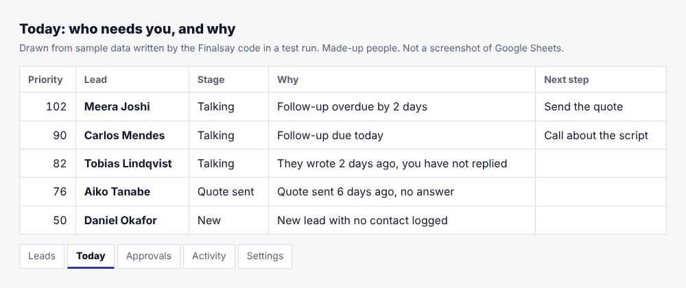
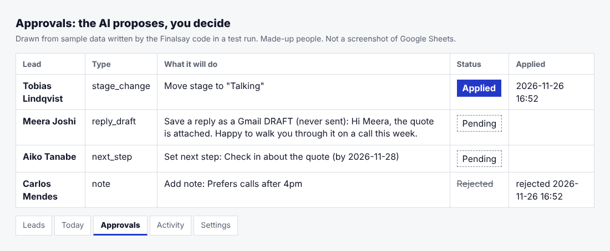
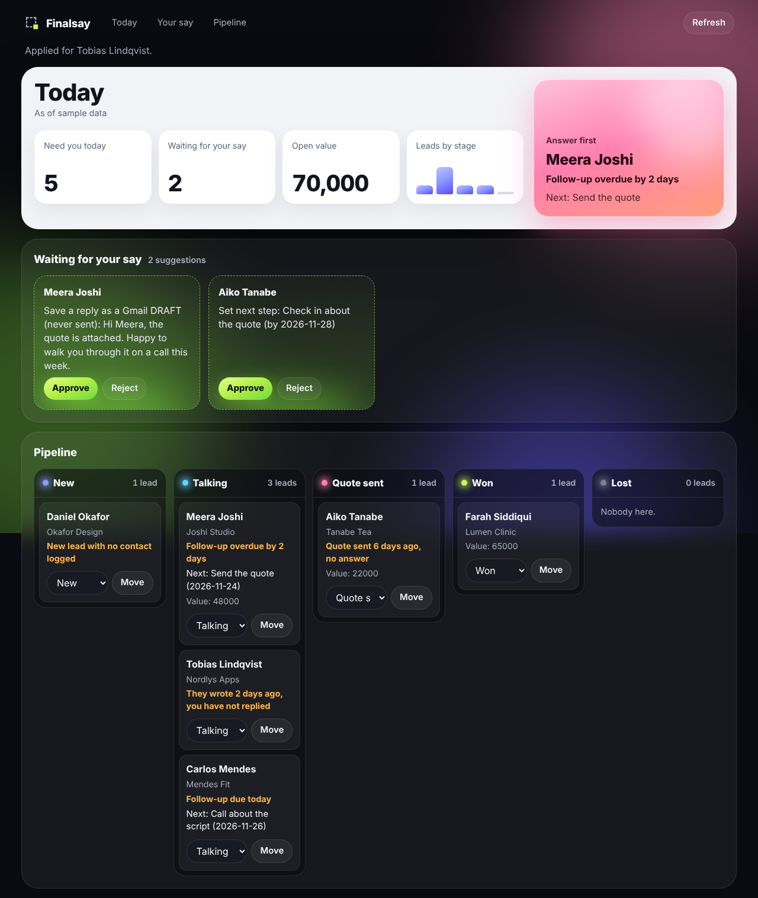
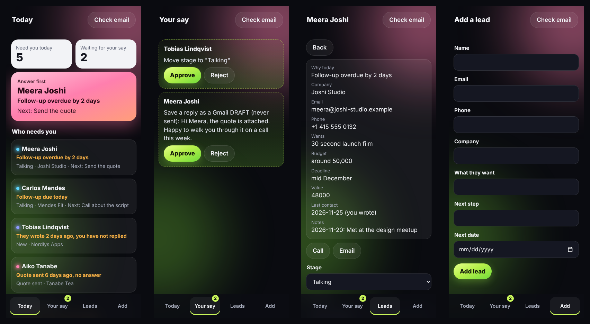

<p>
  <picture>
    <source media="(prefers-color-scheme: dark)" srcset="brand/logo/finalsay-lockup-reversed.svg">
    
  </picture>
</p>

# The CRM that lives in your Google account

Website and guide: [vaghelabhavesh.com/finalsay](https://vaghelabhavesh.com/finalsay.html)

Label a client email in Gmail. Finalsay adds the lead to a Google Sheet, keeps a list of who needs you today and why, and, if you turn the AI on, suggests the next move. You approve each suggestion with one click. Replies are saved as drafts. Nothing is ever sent for you.

Free. Open source (MIT). No server to host and no account to create with anyone. The Sheet is the database, and it is yours.

> **Version 0.1. Run once on one real Google account (26 Nov 2026).** There, setup, email capture, the Today list, approvals, reply drafts and the phone page worked, and the built-in self-check passed 13 of 13 checks that applied. The logic also passes 125 automated tests against stand-ins. AI, a real phone and several other parts are still untested. Read [What is not verified yet](#what-is-not-verified-yet) before you rely on it.

## What you get

**1. A list of who needs you today, with the reason in plain words.** No AI is involved in this list. It is a handful of rules you can read in `src/Core.js`.



**2. An Approvals tab.** The AI proposes. You set Status to Approve or Reject. Only then does anything change.



**3. A board**: today's numbers, who to answer first, suggestions waiting for your say, and the pipeline by stage.



**4. A phone app for iPhone and Android.** It is a web page served from your own Google account that you add to your home screen, not an app from the App Store or Google Play. See who needs you, approve or reject suggestions, call or email a lead, update a lead, or add one after a call. Setup is in [SETUP.md](SETUP.md) step 8. It has not been tried on a real phone yet.



The pictures are drawn from sample data with made-up people. They are not screenshots of Google Sheets.

## How it works

- **Google Sheet = database.** Five tabs: Leads, Today, Approvals, Activity, Settings.
- **Gmail label = capture.** Only threads carrying your label (default `CRM`) are read. The rest of your mailbox is not touched.
- **Apps Script = the program.** It runs on Google's side, under your own account. There is nothing to deploy.
- **AI = optional helper.** Off by default. When on, it fills in empty fields (company, what they want, budget, deadline) and proposes next moves. It writes in pencil. You sign in ink.
- **Google Docs = proposals.** A template with `{{placeholders}}` becomes a proposal for the selected lead.

What happens without a click: new lead rows, last-contact dates, AI filling fields that are empty, and the Today list.
What never happens without a click: stage changes, next steps, notes, reply drafts.
What never happens at all: sending an email. No file in `src/` contains a send call, and a test fails the build if one is added.

## Try it without installing

- [Demo with made-up people](https://bhavesh09798-finalsay-demo.static.hf.space/index.html): the board and the phone page. Nothing is saved, sent or connected.
- [Follow-Up Checker](https://vaghelabhavesh.com/follow-up-checker.html): paste leads from a Google Sheet or a CSV and it lists who needs a reply today, with the same rules as the Today list. It runs in your browser and makes no network calls, so the file stays on your computer.

## Install

**Option A, copy a template Sheet.** [Make a copy](https://docs.google.com/spreadsheets/d/1jbdAclzRHwDlG3_HTqy22Lj9X7BOMD6DRSLsGFZrvhU/copy). The script comes along with the copy, so there is no pasting. Reload your copy, then choose **CRM > Set up**. The template was made on 27 Nov 2026 and checked as far as the copy being made and the CRM menu appearing. **CRM > Set up has not been run on a copy yet.**

**Option B, paste the script.** About ten minutes, no tools needed. Follow [SETUP.md](SETUP.md).

Either way, the first run shows Google's "Google hasn't verified this app" screen, because this is your own copy of a script and not a store app. SETUP.md explains that screen and every permission.

After that, **CRM > Set up** is one click: it makes the tabs and the Gmail label, asks once about daily automation, and then **tests itself** against your Google account. The result is in a Self-check tab, one line per check, in plain words.

## Simple and Pro

- **Simple** shows five columns: Name, Email, Stage, Next Step, Next Date. Type a name and a next step and you have a CRM.
- **Pro** shows every column. Add your own columns anywhere, hide or reorder them, and use formulas. Finalsay finds its columns by their header text and only ever writes single cells, so your formulas are left alone. Add a `Pipeline` column and the board gets a pipeline filter.

Switch with **CRM > More > Switch Simple / Pro**. Nothing is deleted either way.

## The AI, plainly

- Providers: Gemini (default) or any OpenAI-compatible endpoint. Your key is stored in Script Properties, not in the Sheet.
- **When AI is on, the text of the emails you labelled is sent to the provider you chose.** Read that provider's data terms first. This project makes no claim about what any provider does with it.
- The model name in Settings is a default that may be out of date. Model names change often. Check your provider's current list.
- The AI's answer is treated as untrusted data. Finalsay reads a fixed set of fields from it and ignores everything else, including any claim that it "did" something.
- Want nothing to leave your machine? There is an experimental page for local models. See [docs/LOCAL-AI.md](docs/LOCAL-AI.md).

## Honest limits

- **A Google Sheet is not a database.** This is built for one person or a small team: up to a few thousand leads and a handful of editors. Past that it will get slow, and two people editing the same row can overwrite each other.
- **Google's daily limits apply.** On a free Gmail account, Apps Script allows 90 minutes of trigger runtime, 20,000 web requests and 20,000 email reads and writes a day, and one run may last 6 minutes ([Google's quota page](https://developers.google.com/apps-script/guides/services/quotas), checked 26 Nov 2026). Finalsay stops a capture run early and continues next time.
- **The default Gmail permission is broad.** Google only offers the simple Gmail service with the full-mailbox scope, whose consent text mentions sending and deleting. Finalsay does neither. A narrower option (read plus drafts) is included but experimental.
- **Five fixed stages**: New, Talking, Quote sent, Won, Lost. Custom stage names are not supported in 0.1.
- **Anyone who can edit the Sheet is trusted.** They can change any cell. Share with care. See [docs/BUSINESS.md](docs/BUSINESS.md).
- **Google's permission screen has a tick box per permission, and none is ticked.** Tick "Select all". If you do not, Set up asks again.
- **The Sheets mobile app does not run script menus.** On a phone, use the phone app in the browser (SETUP.md step 8). It needs a connection, has no notifications, and is not a store app.
- **English only** for now.

## Who it is for

| | Works well | Works with care | Use something else |
|---|---|---|---|
| Solo, personal Gmail | Yes | | |
| Small team on one Google Workspace domain | Yes | Roles are Sheet sharing plus protected ranges | |
| Dozens of users, tens of thousands of records, strict audit needs | | | Yes. See [docs/COMPARISON.md](docs/COMPARISON.md) |

The code talks to its data through one small adapter (`src/Store.gs`). ARCHITECTURE.md documents that interface so a larger setup could put a database behind it. No database backend is included.

## What is not verified yet

On 26 Nov 2026 the main path was run once on one personal Gmail account: install, the permission screens, setup, the self-check, capturing a labelled thread, the Today list, approving in the Sheet, a reply draft saved inside the thread, and the phone page and board in desktop Chrome. One run on one account is evidence, not proof for every account.

Still not run against real Google services:

- The phone page on a real iPhone or Android phone, and adding it to the home screen
- AI: the Gemini request format, the default model name, and any other provider
- The daily run firing on schedule
- A second person being refused by the phone page and the board
- Approve and Move buttons inside the board and phone page (approving was tested in the Sheet)
- Threads you already replied to, HTML-only emails, send-as aliases
- The web endpoint for forms (CORS, webhook tools)
- Proposal documents made from a template, and "Lock down for a team"
- The narrow Gmail permission path, calendar capture, the local AI page and the MCP server

The built-in self-check (**CRM > More > Run self-check**) tests several of these on your own account in one click.

The full list with details is in [STATUS.md](STATUS.md).

## Documents

- [SETUP.md](SETUP.md): install, permissions, every optional part
- [PRIVACY.md](PRIVACY.md): what data goes where
- [SECURITY.md](SECURITY.md): what is defended, what is not, how to report a problem
- [ARCHITECTURE.md](ARCHITECTURE.md): files, data flow, the storage adapter
- [docs/BUSINESS.md](docs/BUSINESS.md): teams, roles, audit trail, backup, deleting data
- [docs/LOCAL-AI.md](docs/LOCAL-AI.md) and [docs/MCP.md](docs/MCP.md): experimental parts
- [docs/FAQ.md](docs/FAQ.md) and [docs/COMPARISON.md](docs/COMPARISON.md)
- [CONTRIBUTING.md](CONTRIBUTING.md), [CHANGELOG.md](CHANGELOG.md)

## Run the tests

```
npm test          # 125 tests, Node 20 or newer, no dependencies to install
npm run check     # syntax check of every script file
```

## Licence

MIT. Copyright 2026 Bhavesh Vaghela. The Finalsay name and logo have their own short terms in [brand/LICENSES.md](brand/LICENSES.md).

Finalsay is an independent project. It is not made, endorsed or supported by Google.
